# 高一化学十月阶段性测试（B 卷）

> 原题整理版（已移除答案及手写批注）

**可能用到的相对原子质量：** C：12，H：1，O：16，Na：23。

## 第一部分 选择题（共 42 分）

一、选择题（本题包括 21 小题，每小题 2 分，共 42 分。每小题只有一个选项符合题意）。

**1.** 下列有关物质分类的组合，正确的是（　　）

| 分类组合 | 酸 | 碱 | 盐 | 碱性氧化物 | 酸性氧化物 |
| --- | --- | --- | --- | --- | --- |
| A | H₂SO₄ | Cu₂(OH)₂CO₃ | NaHCO₃ | SiO₂ | CO₂ |
| B | HCl | NaOH | NaCl | Na₂O | CO |
| C | NH₃ | NaOH | CaCl₂ | MgO | SO₃ |
| D | HNO₃ | KOH | CaCO₃ | CaO | SO₂ |

A. A  
B. B  
C. C  
D. D  

**2.** 我国科研工作者将嫦娥五号采集的月球玄武岩中的磷灰石煅烧，反应的化学方程式为：

2Ca₅(PO₄)₃OH  —高温→  2Ca₃(PO₄)₂ + Ca₄O(PO₄)₂ + H₂O。下列说法正确的是（　　）

A. H₂O 中氢元素的化合价为 −2  
B. Ca₃(PO₄)₂ 中阳离子的符号为 Ca⁺  
C. Ca₃(PO₄)₂ 中 P 元素化合价为 +5  
D. Ca₃(PO₄)₂ 由四种元素组成  

**3.** 下列变化不能通过一步反应实现的是（　　）

A. Na₂CO₃ → NaOH  
B. Fe₂O₃ → Fe(OH)₃  
C. Fe → Fe₃O₄  
D. H₂SO₄ → HNO₃  

**4.** 以下物质中，不能与 SO₂ 发生反应的是（　　）

A. CaCl₂  
B. Ca(OH)₂  
C. CaO  
D. H₂O  

**5.** 既能与锌发生置换反应，又能与烧碱发生复分解反应的是（　　）

A. CuCl₂ 溶液  
B. NaCl 溶液  
C. MgSO₄ 溶液  
D. K₂CO₃ 溶液  

**6.** 下列物质中，属于电解质的是（　　）

A. 乙醇  
B. 食盐水  
C. BaSO₄  
D. Mg  

**7.** 胶体最本质的特征是（　　）

A. 具有丁达尔效应  
B. 可以通过滤纸  
C. 一定条件下会聚沉  
D. 分散质颗粒的直径在 1 nm～100 nm 之间  

**8.** 下列化学用语或图示表达不正确的是（　　）

A. Na⁺ 的结构示意图：

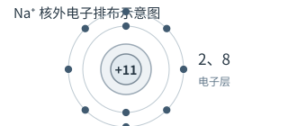

B. NaCl 溶液中的水合离子：

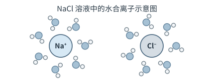

C. NaHSO₄ 在水中电离：NaHSO₄ = Na⁺ + H⁺ + SO₄²⁻  
D. 中子数为 46 的 Se，其核素符号为 ⁸⁰₃₄Se

**9.** 下列叙述正确的是（　　）

A. 易溶于水的物质一定是电解质  
B. 由一种元素组成的物质一定是纯净物  
C. 液态氯化氢不能导电，但氯化氢是电解质  
D. 电解质在水溶液中一定能导电  

**10.** NaCl、Cl₂、NaClO、ClO₂、HClO₄ 是按某一规律排列的。
下列选项中也完全按照此规律排列的是（ ）

A. CH₄、Na₂CO₃、C、CO₂、NaHCO₃  
B. Na₂S、S、SO₂、Na₂SO₃、H₂SO₄  
C. FeCl₃、Fe、FeCl₂、Fe(OH)₃、Fe(SCN)₃  
D. NH₃、N₂、NO、NO₂、NaNO₃  

**11.** 下列“实验结论”与“实验操作及现象”不相符的一组是（　　）

| 选项 | 实验操作及现象 | 实验结论 |
| --- | --- | --- |
| A | 向某溶液中加入紫色石蕊溶液，变红 | 该溶液显酸性 |
| B | 向某溶液中加入 AgNO₃ 溶液，有白色沉淀生成 | 该溶液中含有 Cl⁻ |
| C | 向某溶液中加入稀盐酸，有无色气体产生 | 溶液中可能有 CO₃²⁻ |
| D | 向某溶液中加入足量稀盐酸，无明显现象，再加入 BaCl₂ 溶液，有白色沉淀产生 | 该溶液中含有 SO₄²⁻ |

**12.** NaCl 是一种常见的电解质，其导电示意图如图所示，其中电极 a、b、c、d 均与电源相连。下列说法正确的是（　　）

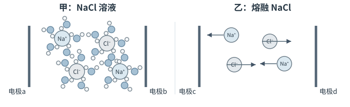

A. 由上图可以看出 NaCl 在外电场的作用下能电离出自由移动的离子  
B. 由上图可以看出 NaCl 在任何状态下都可以导电  
C. 上图乙中的 NaCl 处于熔融状态  
D. 上图电极 a、c 连接电源负极，b、d 连接电源正极  

**13.** 能用 H⁺ + OH⁻ = H₂O 表示的是（　　）

A. NaOH 溶液和 CO₂ 的反应  
B. Ba(OH)₂ 溶液和稀硫酸的反应  
C. NaOH 溶液和盐酸的反应  
D. 氨水和稀硫酸的反应  

**14.** 在强碱性无色透明溶液中，能大量共存的离子组是（　　）

A. Na⁺、Ca²⁺、Cl⁻、CO₃²⁻  
B. NH₄⁺、Mg²⁺、SO₄²⁻、Cl⁻  
C. K⁺、S²⁻、Cl⁻、Na⁺  
D. Al³⁺、Cu²⁺、SO₄²⁻、Cl⁻  

**15.** 下列离子方程式中，正确的是（　　）

A. 将硫酸铜溶液与氢氧化钡溶液混合：Ba²⁺ + SO₄²⁻ = BaSO₄↓  
B. 将稀硫酸滴在铜片上：Cu + 2H⁺ = Cu²⁺ + H₂↑  
C. 向氢氧化钡溶液中滴加稀硫酸：Ba²⁺ + OH⁻ + H⁺ + SO₄²⁻ = BaSO₄ + H₂O  
D. 将稀盐酸滴在石灰石上：CaCO₃ + 2H⁺ = Ca²⁺ + CO₂↑ + H₂O  

**16.** 在“宏观—微观—符号”之间建立联系，是化学学科特有的思维方式。下图是某反应的微观示意图，相关说法不正确的是（　　）

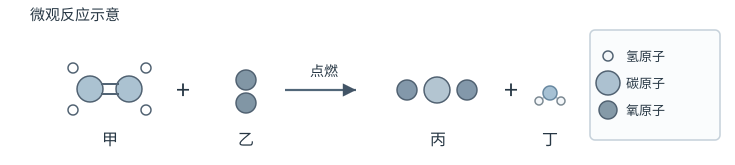

A. 此反应是物质燃烧的反应  
B. 反应物甲的化学式是 C₂H₄  
C. 生成的丙、丁分子个数比为 1∶2  
D. 参加反应的甲、乙物质的质量比为 7∶24  

**17.** 下列实验中，不能达到实验目的是（　　）

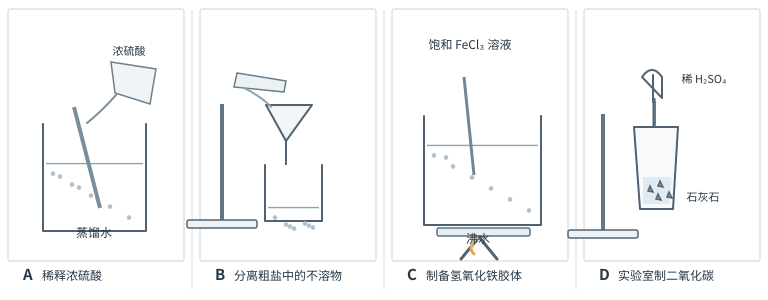

**18.** 加入 NaOH 溶液后，溶液中离子数目不会减少的是（　　）

A. Cu²⁺  
B. HCO₃⁻  
C. Fe³⁺  
D. SO₄²⁻  

**19.** 如图所示甲、乙、丙、丁四种物质间相互关系中的反应，均为初中化学常见反应（“—”表示相连的两种物质能反应，“→”表示通过一步反应能实现转化），下列选项符合图示关系的是（　　）

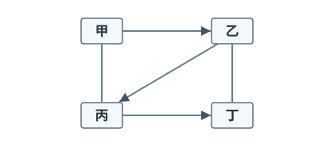

| 选项 | 甲 | 乙 | 丙 | 丁 |
| --- | --- | --- | --- | --- |
| A | H₂O | O₂ | CaO | Ca(OH)₂ |
| B | H₂SO₄ | HCl | MgCl₂ | Mg(OH)₂ |
| C | HCl | CO₂ | CaCO₃ | H₂O |
| D | FeSO₄ | FeCl₂ | Cu | CuO |

A. A  
B. B  
C. C  
D. D  

**20.** 双碱法脱除烟气中 SO₂ 的过程如下图所示。下列说法中不正确的是（　　）

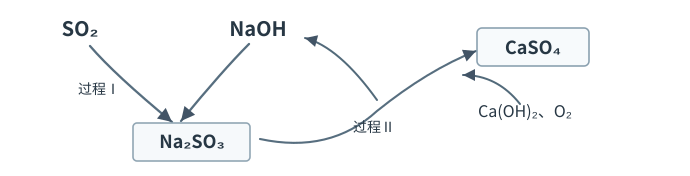

A. 双碱法中的“双碱”是指 NaOH 和 Ca(OH)₂  
B. 过程Ⅰ和过程Ⅱ中碱的作用不同  
C. 脱除过程中硫元素的化合价一直没有变化  
D. 脱除 SO₂ 的过程中，NaOH 可以循环利用  

**21.** 为除去粗盐水中含有的杂质 SO₄²⁻、Ca²⁺ 和 Mg²⁺，得到精制食盐水，某同学设计了如下实验流程，以下说法正确的是（　　）

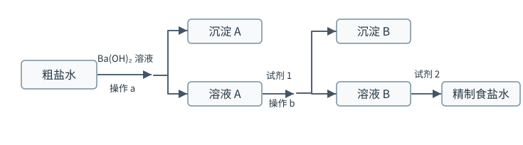

A. 沉淀 A 是 BaSO₄  
B. 溶液 A 中微粒主要有：Cl⁻、Ba²⁺、OH⁻、Na⁺、Ca²⁺  
C. 试剂 1 既可以是 Na₂CO₃，也可以是 Na₂SO₄  
D. 加入试剂 2 的目的是除去 OH⁻、CO₃²⁻、SO₄²⁻  

## 第二部分 非选择题（共 58 分）

**22.** （14 分）

Ⅰ. 画出以下几种微粒的原子结构示意图或离子结构示意图：

（1）碳原子：________；K：________；Al³⁺：________；硫离子：________。

Ⅱ. 现有下列物质：①NaCl 晶体；②干冰；③液态醋酸；④铜；⑤BaSO₄ 固体；⑥蔗糖；⑦酒精；⑧熔化的 KNO₃；⑨稀盐酸；⑩Na₂O 固体。

请回答下列问题（填写序号）：

（2）以上物质中属于电解质的是________。

（3）以上物质中属于非电解质的是________。

（4）以上物质中能导电的是________。

**23.** （32 分）

（1）KClO₃：________。     （2）H₂SO₄：________。     （3）NaHSO₄：________。

（4）Ba(OH)₂：________。     （5）NaHCO₃：________。     （6）CH₃COONa：________。

Ⅱ. 写出下列反应的离子方程式：

（1）硫酸铜溶液与氢氧化钡溶液反应：________________。

（2）氯化钠和硝酸银：________________。

（3）CO₂ 能使澄清的石灰水变浑浊：________________。

（4）NaHSO₄ 溶液与 Ba(OH)₂ 溶液恰好沉淀：________________。

（5）氢氧化钠加入少量的二氧化碳：________________。

（6）氢氧化铝治疗胃酸过多：________________。

（7）盐酸溶解氧化镁：________________。

（8）硫酸镁与氢氧化钡：________________。

（9）生锈的铁钉与盐酸：________________；________________。

**24.** （12 分）某同学探究溶液的导电性实验。（滴定管是用于滴加溶液的仪器。）

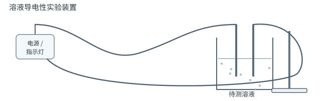

（1）若烧杯中所盛液体是 H₂SO₄ 溶液，滴定管内是 CH₃COONa 溶液，随着 CH₃COONa 溶液的滴加，灯泡逐渐变暗。写出发生反应的离子方程式：________________。

（2）若烧杯中所盛液体是 NaHSO₄ 溶液，滴定管内是 Ba(OH)₂ 溶液。随着 Ba(OH)₂ 溶液的滴加，灯泡逐渐变暗，当滴加至溶液呈中性时的离子方程式：________________，继续滴加，发生反应的离子方程式为________________。

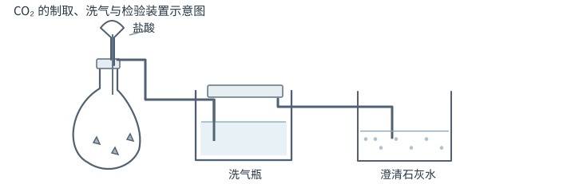

（3）某实验小组用 CaCO₃ 和盐酸制取并检验 CO₂，进行如下实验：

小组同学组装好装置后进行两组实验，并用计算机记录澄清石灰水导电能力随气体通入量的变化如下图所示：

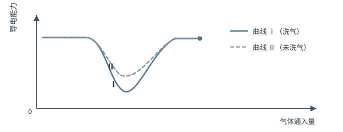

① 写出制备 CO₂ 的方程式：________________。

② 曲线Ⅰ中导电能力上升过程中发生反应的离子方程式为________________。

③ 曲线Ⅱ的最低点高于曲线Ⅰ的原因可能是________________。
