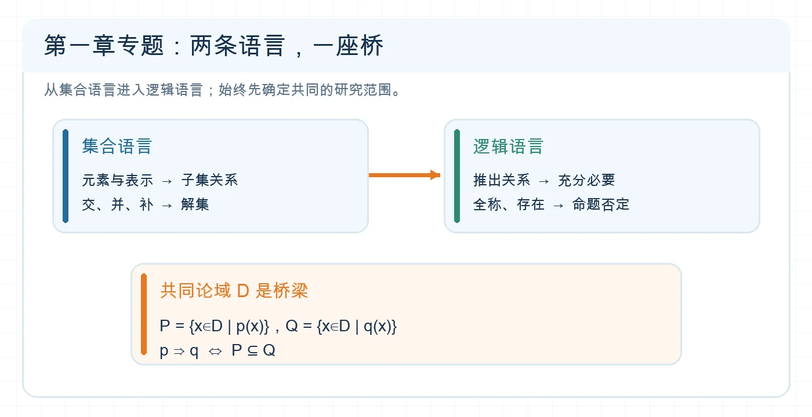

# 集合与常用逻辑用语：专题学习导航

## 这套专题怎样用

这套文档用于**学完章节后，遇到题目却不知道怎样下手**时补缺。先做下表中的一句话自测；不会的，就进入相应专题。每篇先给必要概念，再示范“识别题目—选方法—检查结果”，最后用 3 道递进练习检验能否迁移。需要系统重学概念时，沿篇末链接回到章节笔记。

| 遇到的问题 | 先问自己 | 对应专题 |
| --- | --- | --- |
| 不知道集合中的元素究竟是什么 | 描述法花括号前的代表元素是谁？ | [[01-识别集合并选择表示方法]] |
| 把 $\in$、$\subseteq$、空集和子集个数弄混 | 两边是元素还是集合？有没有漏掉空集？ | [[02-判断子集关系与计数]] |
| 交并补或区间端点算错 | 全集、运算次序和端点是否明确？ | [[03-完成集合运算与计数]] |
| 参数或新定义题无法转化 | 先拆成哪些元素条件或原有运算？ | [[04-处理集合参数与新定义]] |
| “充分”“必要”的方向记反 | 条件能否推出结论，反向又如何？ | [[05-判断充分必要条件]] |
| 量词命题的真假和否定写错 | 变量范围、量词、结论是否逐项处理？ | [[06-判断量词命题与写出否定]] |

## 知识网络

```text
确定研究对象和范围
  └─ 集合表示 → 元素/子集关系 → 交、并、补
                         ├─ 参数与新定义：把新问题化成元素条件
                         └─ 条件集合：p ⇒ q 等价于 P ⊆ Q
                                                └─ 量词与否定：判断“全部”或“存在”
```

这里的 $P=\{x\in D\mid p(x)\}$、$Q=\{x\in D\mid q(x)\}$ 必须使用**同一个论域** $D$。只有说清论域，补集和量词命题才有确定含义。


<!-- 图片描述：数学知识结构图。左侧展示“集合语言：元素与表示→子集关系→交并补→解集”，右侧展示“逻辑语言：推出关系→充分必要→量词与否定”，中间用共同论域 D 连接，底部明确 p⇒q 等价于 P⊆Q。白色浅网格背景、深蓝文字与线条、橙色突出桥梁。 -->

**读图提示：** 做逻辑题时先把条件写成同一论域中的集合，再把“能否推出”看成集合包含；这正是专题 02、05 的连接点。

## 建议学习路径

1. 先做各篇的“1 分钟自测”。答对且能解释理由的专题，可直接做迁移练习。
2. 集合基础薄弱时按 01→02→03→04；逻辑用语薄弱时按 05→06。04 与 05 都依赖集合关系，建议先掌握 02。
3. 每题答错后先归因：**对象或符号、边界与空集、推出方向、量词与论域、计算**。再回看对应的易错反例，不要只抄答案。
4. 练习分为“概念检查—方法应用—进阶迁移”。进阶题暂时做不出时，先保证前两题能独立完成。

## 内容与来源说明

本套专题依据现有[[核心知识点大纲]]、1.1—1.5 章节笔记，并参考《高中必刷题数学必修第一册狂K重点 132》第一章（参考资料原文件的来源页 6—20）重组。例题和练习按本套教学目标重新编写；参考资料经 OCR 格式化，书中的符号和推论须逐一核对后使用。例如“两个不包含关系可以传递”的说法并不成立，本套专题不采用这一结论。

## 与章节笔记的关系

章节笔记负责完整解释概念、教材情境与大量练习；这套专题负责把同一知识放入可识别、可操作的解题任务中。遇到定义不清时回章节笔记，遇到题目不会做时从本导航进入专题。
