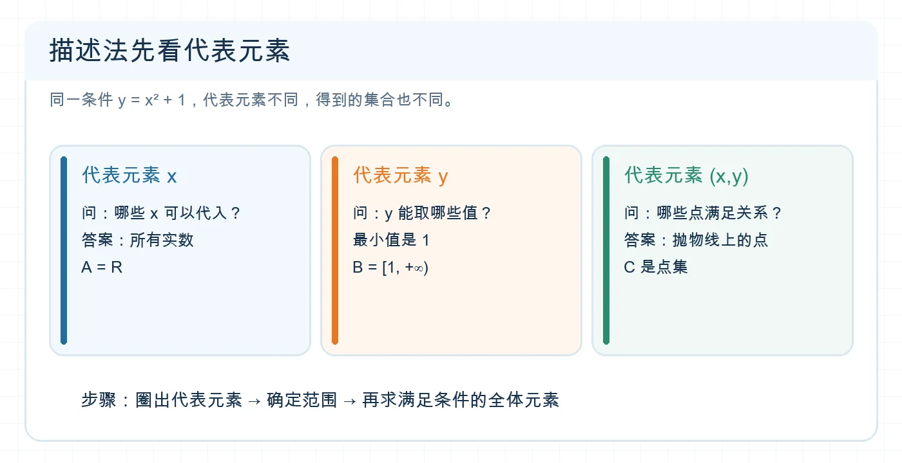

# 识别集合并选择表示方法

## 专题定位

题目给出自然语言、列举式或描述式时，先确定**元素是什么**、**取值范围是什么**，再选择最清楚的表示方法。它是子集判断和集合运算的入口。

## 1 分钟自测

设 $S=\{x\in\mathbb R\mid x^2=4\}$。$-2\in S$ 吗？$S$ 应写成什么列举式？再说出 $\{(x,y)\mid y=x^2\}$ 的元素是什么。若把最后一个集合看作数集，说明代表元素还没有辨清。

**自测核对：** $-2\in S$，$S=\{-2,2\}$；最后一个集合的元素是有序数对 $(x,y)$。

## 必备知识与知识网络

- 集合的元素具有确定性、互异性、无序性；列举时重复的值只保留一次。
- $a\in A$ 表示元素与集合的关系。$\{a\}$ 是集合，不能把 $a$ 和 $\{a\}$ 当成同一个对象。
- 列举法适合元素少且能列全；描述法 $\{x\in D\mid P(x)\}$ 适合用条件界定；区间适合表示实数的连续范围。
- 描述法的代表元素可以是 $x$、$y$ 或 $(x,y)$，分别可能得到不同的集合。

```text
题意 → 代表元素 → 论域和条件 → 求出或刻画所有元素 → 选表示法 → 去重与核对
```


<!-- 图片描述：用 y=x²+1 对比描述法的三种代表元素：x 对应全部实数，y 对应 [1,+∞)，有序数对 (x,y) 对应抛物线上的点。三栏并列，每栏标明要问的问题和得到的集合；白色浅网格背景、深蓝线条、橙色突出值域。 -->

**读图提示：** 先读花括号里的代表元素，再读竖线后的条件；同一个关系可以给出定义域、值域或点集。

## 识题信号与解题步骤

| 题目出现 | 先做什么 |
| --- | --- |
| “下列对象能否组成集合” | 检查成员资格能否明确判定。 |
| $\{x\mid \cdots\}$、$\{y\mid \cdots\}$、$\{(x,y)\mid\cdots\}$ | 圈出代表元素，分别判断是定义域、值域还是点集。 |
| 含方程、绝对值或重复表达式 | 先解条件，再合并相同元素。 |
| 要比较两个集合 | 化到相同类型的元素表示，再逐项比较。 |

## 例题精讲

**例 1｜同一个关系，三个集合。** 在 $x,y\in\mathbb R$ 且 $y=x^2+1$ 的条件下，求
$A=\{x\mid y=x^2+1\}$、$B=\{y\mid y=x^2+1\}$，并说明 $C=\{(x,y)\mid y=x^2+1\}$ 是什么。

**识别：** 先看花括号中的代表元素。**求解：** 任意实数 $x$ 都对应一个 $y$，故 $A=\mathbb R$；由于 $x^2\ge0$，$B=[1,+\infty)$；$C$ 的元素是满足关系的有序数对，是平面上的抛物线点集。**检查：** $1\in B$，因为 $x=0$ 可以取到；$(0,1)\in C$，但数 $1$ 不是 $C$ 的元素。

**例 2｜互异性。** 求 $T=\{a,|a|,a^2\}$ 在 $a=-1$ 时的元素个数。代入得到 $\{-1,1,1\}=\{-1,1\}$，所以 $|T|=2$。集合计数发生在**去重以后**。

## 易错反例

- “方程有两个根，所以集合一定有两个元素”不成立：$(x-1)^2=0$ 的根虽写作两次，根集只有 $\{1\}$。
- $\{x\mid x^2=1\}$ 是 $\{-1,1\}$；$\{x^2\mid x^2=1\}$ 是 $\{1\}$。条件相似，代表元素不同。

## 考法总结

常见考法是判断成员、集合相等、表示法互化，或先识别代表元素再做集合关系。识题时先写“元素类型”，能挡住多数误读。

## 专题练习

1. **概念检查：** 将 $A=\{x\in\mathbb Z\mid -2<x\le2\}$ 写成列举式。
2. **方法应用：** 在 $x\in\mathbb R$ 且 $y=(x-1)^2$ 下，分别写出 $\{x\mid y=(x-1)^2\}$ 与 $\{y\mid y=(x-1)^2\}$。
3. **进阶迁移：** 设 $B=\{m,|m|,m^2\}$。求所有使 $|B|=1$ 的实数 $m$。

## 练习答案与解析

1. $A=\{-1,0,1,2\}$。整数论域与右端闭区间都要保留。
2. 前者是 $\mathbb R$，后者是 $[0,+\infty)$；平方可取到 $0$。
3. 三个表达式必须相等。由 $m=|m|$ 得 $m\ge0$，再由 $m=m^2$ 得 $m=0$ 或 $1$；两者代回都成立。

## 继续学习

- 前置详解：[[1.1-集合的概念]]
- 下一步：[[02-判断子集关系与计数]]、[[03-完成集合运算与计数]]
- 返回导航：[[00-学习导航]]
