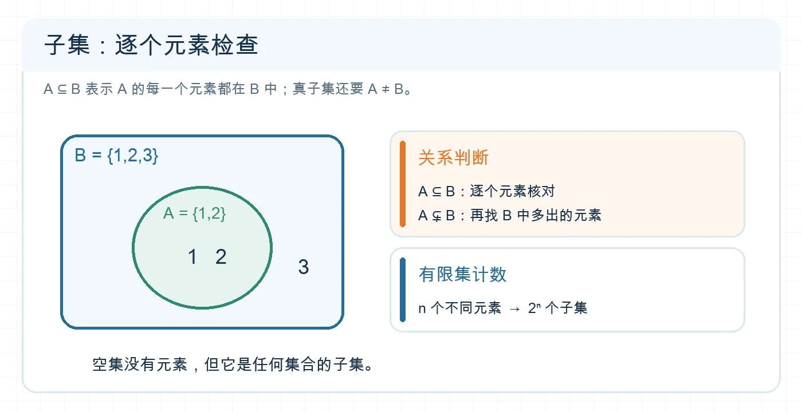

# 判断子集关系与计数

## 专题定位

解决元素与集合、子集与真子集、空集和有限集合计数问题。核心动作是按定义逐一核对元素，而不是仅凭图形大小或符号外观判断。

## 1 分钟自测

若 $A=\varnothing$，$B=\{0\}$，判断 $A\subsetneq B$、$0\in A$、$\varnothing\in B$ 的真假。若把后两项混淆，先补元素与集合的层级。

**自测核对：** 依次为真、假、假；$B$ 的元素是数字 $0$，不是空集。

## 必备知识与知识网络

- $A\subseteq B$：$A$ 的每个元素都是 $B$ 的元素；$A\subsetneq B$ 还要求 $A\ne B$。
- $A=B$ 等价于 $A\subseteq B$ 且 $B\subseteq A$。
- $\varnothing\subseteq A$ 对任何集合 $A$ 成立；只有 $A\ne\varnothing$ 时，$\varnothing\subsetneq A$。
- 含 $n$ 个不同元素的有限集合有 $2^n$ 个子集、$2^n-1$ 个真子集、$2^n-2$ 个非空真子集（最后一式适用于 $n\ge1$）。

```text
看对象层级 → 写出元素 → 判断包含 → 检查是否相等 → 若计数，区分必选/可选/禁选
```


<!-- 图片描述：画 B={1,2,3} 中包含 A={1,2} 的集合关系图，突出 B 比 A 多一个元素 3，因此 A 是 B 的真子集；右侧配逐元素检查与 n 个不同元素有 2^n 个子集的提示，底部说明空集是任何集合的子集。白色浅网格背景、深蓝轮廓、橙色强调判断。 -->

**读图提示：** 图中的 $3$ 是证明 $A\ne B$ 的证据；数子集时，先确认集合里有几个**不同**元素。

## 识题信号与解题步骤

| 题目出现 | 做法 |
| --- | --- |
| 符号填空 | 先判左侧是元素还是集合，再选 $\in$ 或 $\subseteq$ 等。 |
| $A\subseteq B$ 且 $A$ 含参数 | 先判断 $A$ 是否可能为空，再处理非空情形。 |
| 求中间集合 $X$ 的个数 | 锁定必选元素，给其余可选元素各两种状态，再排除不允许的端点集合。 |
| 证明集合相等 | 分别证明两个方向的包含。 |

## 例题精讲

**例 1｜中间集合计数。** 已知 $\{1\}\subseteq X\subsetneq\{1,2,3,4\}$，求 $X$ 的个数。

**识别：** $1$ 必选，$2,3,4$ 可选，但 $X$ 不能等于右侧集合。**求解：** $2^3-1=7$。**检查：** $X=\{1\}$ 可以，$X=\{1,2,3,4\}$ 不可以。

**例 2｜层级辨析。** 设 $A=\{\varnothing,\{0\}\}$。则 $\varnothing\in A$ 与 $\{0\}\in A$ 都成立；$0\notin A$。由于空集是任何集合的子集，$\varnothing\subseteq A$ 也成立。同一个符号在不同语句中可以扮演元素或集合，须看关系号两侧。

## 易错反例

- 由 $A\nsubseteq B$、$B\nsubseteq C$ **不能**推出 $A\nsubseteq C$。取 $A=\{1\}$、$B=\{2\}$、$C=\{1\}$：前两句真，结论假。
- $\varnothing$、$\{\varnothing\}$、$\{0\}$ 是三个不同的集合；后两个都只有一个元素，但元素不同。
- 数子集前先去重：$\{1,1,2\}$ 有两个元素，因此有 $2^2=4$ 个子集。

## 考法总结

考题常用“至少包含”“真包含”“非空”等限制改变计数。把每个限制翻译为必选、可选或禁选，比直接套 $2^n$ 安全。

## 专题练习

1. **概念检查：** 判断 $\varnothing\in\{\varnothing\}$、$\varnothing\subseteq\{\varnothing\}$、$0\in\{\varnothing\}$。
2. **方法应用：** 求满足 $\{a,b\}\subseteq X\subseteq\{a,b,c,d\}$ 的集合 $X$ 的个数，四个字母互不相同。
3. **进阶迁移：** 四个字母互不相同。求满足 $\{a\}\subsetneq X\subsetneq\{a,b,c,d\}$ 且 $b\notin X$ 的 $X$ 的个数。

## 练习答案与解析

1. 真、真、假。$\{\varnothing\}$ 的唯一元素是 $\varnothing$，不是数字 $0$。
2. $a,b$ 必选，$c,d$ 各可选或不选，共 $2^2=4$ 个。
3. $a$ 必选、$b$ 禁选，$c,d$ 可选；左端必须真包含，故不能同时不选。右端全集含 $b$，无论如何不会取到。共 $2^2-1=3$ 个。

## 继续学习

- 前置详解：[[1.2-集合间的基本关系]]
- 下一步：[[03-完成集合运算与计数]]、[[05-判断充分必要条件]]
- 返回导航：[[00-学习导航]]
