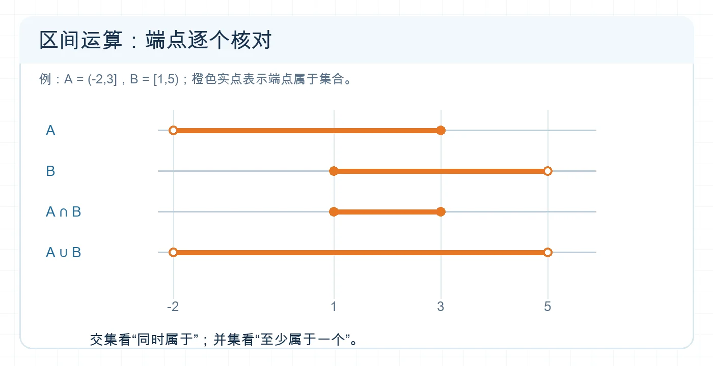

# 完成集合运算与计数

## 专题定位

看到“且、或、不在、至少一个”时，把语言转成交、并、补；处理实数集时再用数轴核对端点。有限集合的计数则要避免把交集重复计算。

## 1 分钟自测

在全集 $U=\mathbb R$ 中，$A=(-1,2]$、$B=[2,4)$。写出 $A\cap B$、$A\cup B$ 和 $\complement_U A$。若只会写区间却说不清端点为何包含，先复习本篇。

**自测核对：** 依次为 $\{2\}$、$(-1,4)$、$(-\infty,-1]\cup(2,+\infty)$。

## 必备知识与知识网络

- $A\cap B=\{x\mid x\in A\text{ 且 }x\in B\}$；$A\cup B=\{x\mid x\in A\text{ 或 }x\in B\}$。“或”允许同时属于两者。
- 补集依赖全集：$\complement_U A=\{x\in U\mid x\notin A\}$。差集 $A\setminus B=A\cap\complement_U B$。
- 德·摩根律：$\complement_U(A\cup B)=(\complement_U A)\cap(\complement_U B)$；$\complement_U(A\cap B)=(\complement_U A)\cup(\complement_U B)$。
- 有限集：$|A\cup B|=|A|+|B|-|A\cap B|$。重叠部分只算一次。

```text
明确全集 → 把集合化为区间或元素表 → 画数轴/画分类格 → 按“且、或、不在”运算 → 核对端点与重复计数
```


<!-- 图片描述：在同一数轴上分别画 A=(-2,3]、B=[1,5)、A∩B=[1,3]、A∪B=(-2,5)。空心圆表示不包含端点，实心圆表示包含端点；四条数轴对齐 -2、1、3、5，白色浅网格背景、深蓝文字、橙色区间。 -->

**读图提示：** 交集只保留两条原区间重叠的部分；并集覆盖两者全部，最后逐个检查 $-2,1,3,5$ 的开闭。

## 识题信号与解题步骤

| 题目出现 | 方法 |
| --- | --- |
| 区间交、并、补 | 在同一数轴上标出所有端点；先算括号内，再处理补集。 |
| “在 $A$ 中但不在 $B$ 中” | 直接写 $A\setminus B$，再转成 $A\cap\complement_U B$。 |
| “至少参加一项” | 求并集人数；“两项都参加”是交集人数。 |
| “都不满足” | 对并集取补；可用德·摩根律分别取补再求交。 |

## 例题精讲

**例 1｜区间端点。** 在 $U=\mathbb R$ 中，$A=(-2,3]$、$B=[1,5)$。求 $A\cap B$、$A\cup B$、$\complement_U A$。

**识别：** $1$ 同时属于两集合，$3$ 也属于两集合；$-2$ 不属于 $A$，$5$ 不属于 $B$。**求解：** $A\cap B=[1,3]$，$A\cup B=(-2,5)$，$\complement_U A=(-\infty,-2]\cup(3,+\infty)$。**检查：** 把 $-2,1,3,5$ 逐一代回成员条件。

**例 2｜容斥。** 某班 18 人参加数学活动，12 人参加物理活动，其中 5 人两项都参加。至少参加一项的有 $18+12-5=25$ 人。不能直接加成 30 人，因为交集的 5 人被算了两次。

## 易错反例

- “$A$ 与 $B$ 没有公共元素，所以没有交集”表述不准确：此时交集是**空集**，即 $A\cap B=\varnothing$。
- $\complement_U A$ 未说明 $U$ 就不能唯一确定。例如 $A=\{1\}$，在 $U=\{1,2\}$ 中补集为 $\{2\}$，在 $U=\{1,2,3\}$ 中则为 $\{2,3\}$。
- 对开闭端点不能只看图上是否“碰到”；必须检验该点是否同时满足成员条件。

## 考法总结

运算题常把方程解集、不等式解集与区间混合给出。先把每个集合单独求清，再执行运算；补集题总先写全集。

## 专题练习

1. **概念检查：** $A=\{1,2,3\}$、$B=\{3,4\}$，求 $A\cap B$、$A\cup B$、$A\setminus B$。
2. **方法应用：** 在 $U=\mathbb R$ 中，$A=(-1,2]$、$B=[2,4)$，求 $A\cap B$、$A\cup B$、$\complement_U A$。
3. **进阶迁移：** 40 名学生中，参加甲活动的有 22 人，参加乙活动的有 19 人，两项都未参加的有 6 人。求两项都参加的人数。

## 练习答案与解析

1. 分别为 $\{3\}$、$\{1,2,3,4\}$、$\{1,2\}$。
2. 分别为 $\{2\}$、$(-1,4)$、$(-\infty,-1]\cup(2,+\infty)$。其中 $2$ 同时属于 $A,B$。
3. 至少参加一项的有 $40-6=34$ 人；交集人数为 $22+19-34=7$。

## 继续学习

- 前置详解：[[1.3-集合的基本运算]]
- 下一步：[[04-处理集合参数与新定义]]
- 返回导航：[[00-学习导航]]
