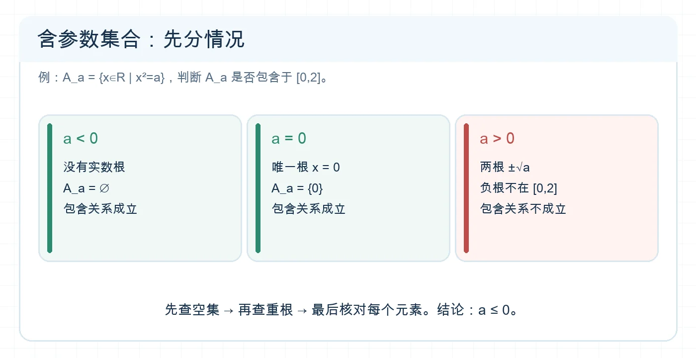
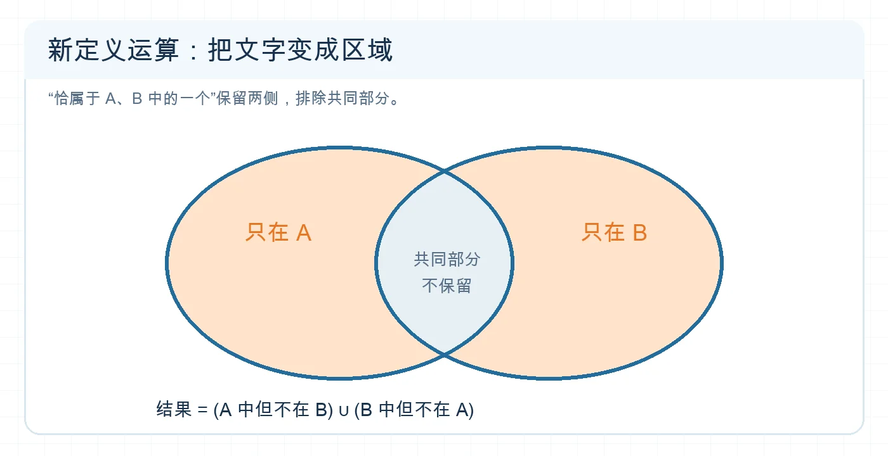

# 处理集合参数与新定义

## 专题定位

这篇是进阶专题：把“含参数的集合关系”和“题目临时定义的运算”还原成已学过的成员条件、区间包含、交并补。先会翻译，再做计算。

## 1 分钟自测

设 $A_a=\{x\in\mathbb R\mid x^2=a\}$。当 $a<0$ 时，$A_a$ 是什么？若题目要求 $A_a\subseteq[0,2]$，能否直接断定 $a=0$？这里空集情形是关键。

**自测核对：** $a<0$ 时 $A_a=\varnothing$，它也是 $[0,2]$ 的子集，所以不能直接断定 $a=0$。

## 必备知识与知识网络

- 含参数集合要先求出随参数变化的元素、区间或元素个数，再施加集合关系。
- 若 $A\subseteq B$，需分别考虑 $A=\varnothing$ 和 $A\ne\varnothing$；若 $A\subsetneq B$，还要排除 $A=B$。
- “元素个数恰为 $k$”先查是否有重根、相同表达式或不符合论域的根。
- 新定义运算只按题中给出的规则执行。可以用一个任意元素 $x$ 判断它何时属于结果集，再翻译为交、并、补、差。

```text
参数题：列元素/求解集 → 按参数分情况 → 翻译集合关系 → 查空集和端点
新定义：逐字读规则 → 逐元素判成员 → 化成熟悉运算 → 用小例子验证
```


<!-- 图片描述：针对 A_a={x∈R|x²=a} 是否为 [0,2] 的子集，分三栏画 a<0 时空集、a=0 时 {0}、a>0 时有正负两根；前两种包含关系成立，第三种因负根不在区间内而失败。白色浅网格背景、深蓝文字、橙色突出分类结论。 -->

**读图提示：** “求根集”必须先于“判断包含”；空集分支即使没有元素，也满足子集条件。

## 识题信号与解题步骤

| 题目出现 | 方法 |
| --- | --- |
| 方程根集含参数 | 先求根并检查重合，再写成真正的集合。 |
| 区间包含含参数 | 左右端点分别列不等式；区间可能为空时先分情况。 |
| 运算符 $\star$、$\triangle$ 等临时定义 | 不沿用熟悉运算法则，先写 $x\in A\star B$ 的充要条件。 |
| 问某性质是否总成立 | 找最小集合验证；若失败，给出反例；若成立，再证明。 |

## 例题精讲

**例 1｜先处理空集。** $A_a=\{x\in\mathbb R\mid x^2=a\}$，求使 $A_a\subseteq[0,2]$ 的 $a$。

**分类：** $a<0$ 时 $A_a=\varnothing$，包含关系成立。$a=0$ 时 $A_a=\{0\}$，成立。$a>0$ 时 $A_a=\{-\sqrt a,\sqrt a\}$，负根不在 $[0,2]$ 中，不成立。**答案：** $a\le0$。若题目另要求 $A_a\ne\varnothing$，答案才缩成 $a=0$。

**例 2｜翻译新运算。** 定义 $A\triangle B=\{x\mid x\text{ 恰属于 }A,B\text{ 中的一个}\}$。当 $A=\{1,2,3\}$、$B=\{2,4\}$ 时，交集中的 $2$ 被排除，故 $A\triangle B=\{1,3,4\}$。一般地，$A\triangle B=(A\setminus B)\cup(B\setminus A)$。这是由定义推得的，不能把 $\triangle$ 自行理解为“交”或“并”。


<!-- 图片描述：用两个相交圆画出“恰属于 A、B 中的一个”这一定义，只将 A\B 与 B\A 两侧涂成橙色，交集保持浅灰并标注不保留；底部说明结果等于两侧差集的并集。白色浅网格背景、深蓝轮廓，清晰展示新定义如何转成已有集合运算。 -->

**读图提示：** 对任意元素只问两次“在 $A$ 吗、在 $B$ 吗”；两次回答恰有一次为“是”，才进入结果集。

## 易错反例

- $A=\{a,1\}$ 在 $a=1$ 时只有一个元素；不能始终按两个元素计数。
- $A\subseteq B$ 不要求 $A$ 非空。漏掉空集会漏参数范围。
- 新定义中的“恰属于一个”排除同时属于两者；普通并集中的“或”包含同时属于两者。两个词不能混用。

## 考法总结

这类题的难点通常不在计算量，而在**定义转换**与**分类完整性**。答案出来后用边界值、重根值和一个简单集合各检验一次。

## 专题练习

1. **概念检查：** $T_a=\{x\in\mathbb R\mid x^2-(a+1)x+a=0\}$。求使 $|T_a|=1$ 的 $a$。
2. **方法应用：** $I_a=[a,a+2]$，求使 $I_a\subseteq[0,3]$ 的 $a$。
3. **进阶迁移：** 定义 $A\star B=\{x\mid x\in A\cup B,\ x\notin A\cap B\}$。求 $\{1,2,3\}\star\{2,3,4\}$，再判断 $A\star A$ 对任意集合 $A$ 是什么。

## 练习答案与解析

1. 多项式分解为 $(x-1)(x-a)$。两根重合时 $a=1$，此时 $T_a=\{1\}$。
2. 要使整段落在 $[0,3]$ 内，需 $a\ge0$ 且 $a+2\le3$，故 $0\le a\le1$。
3. 结果是 $\{1,4\}$；$A\star A=\varnothing$，因为不存在“属于 $A$ 但不属于 $A$”的元素。

## 继续学习

- 前置详解：[[1.1-集合的概念]]、[[1.2-集合间的基本关系]]、[[1.3-集合的基本运算]]
- 相关专题：[[02-判断子集关系与计数]]、[[03-完成集合运算与计数]]
- 返回导航：[[00-学习导航]]
