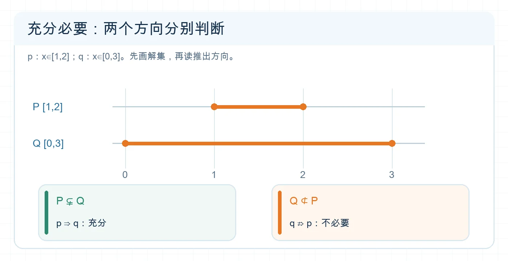

# 判断充分必要条件

## 专题定位

面对“$p$ 是 $q$ 的什么条件”，始终从 $p\Rightarrow q$ 与 $q\Rightarrow p$ 两个方向判断；含参数或区间时，可把命题的真值集合转成包含关系。

## 1 分钟自测

设 $p:x>2$，$q:x>0$，论域为 $\mathbb R$。$p$ 是 $q$ 的充分条件还是必要条件？能否举一个说明逆向不成立的数？若只能背口诀，尚未掌握判断依据。

**自测核对：** $p$ 是 $q$ 的充分不必要条件；$x=1$ 满足 $q$，却不满足 $p$。

## 必备知识与知识网络

| 推出关系 | $p$ 对 $q$ 的关系 | 条件集合 $P,Q$ 的关系 |
| --- | --- | --- |
| $p\Rightarrow q$，$q\nRightarrow p$ | 充分不必要 | $P\subsetneq Q$ |
| $p\nRightarrow q$，$q\Rightarrow p$ | 必要不充分 | $Q\subsetneq P$ |
| 两个方向都成立 | 充要 | $P=Q$ |
| 两个方向都不成立 | 既不充分也不必要 | $P,Q$ 互不包含 |

这里 $P=\{x\in D\mid p(x)\}$、$Q=\{x\in D\mid q(x)\}$，两者必须在同一论域 $D$ 下讨论。证明充要条件时，正向和逆向都要证明。反驳一个推出关系，只需找满足前件而不满足后件的反例。

<!-- 图片描述：同一数轴上画 P=[1,2] 和 Q=[0,3]，显示 P 真包含于 Q；下方分别写 p⇒q 成立、q⇒p 不成立，因此 p 是 q 的充分不必要条件。白色浅网格背景、深蓝数轴、橙色区间与关键结论。 -->

**读图提示：** 从较小的解集 $P$ 可以推出较大的解集 $Q$；反向失败可取 $x=0$，它在 $Q$ 中却不在 $P$ 中。

## 识题信号与解题步骤

| 题目出现 | 方法 |
| --- | --- |
| 文字叙述“$p$ 是 $q$ 的……” | 先固定 $p,q$，画 $p\to q$ 和 $q\to p$ 两个箭头，分别验证。 |
| 条件是方程或不等式 | 先求 $P,Q$，再比较解集。 |
| 要证明充要条件 | 正向写“由 $p$ 得 $q$”，逆向写“由 $q$ 得 $p$”。 |
| 含参数的条件关系 | 把“充分/必要”化成区间包含，再查端点和是否真包含。 |

## 例题精讲

**例 1｜两个方向。** 在 $\mathbb R$ 中，$p:x>2$，$q:x>0$。由 $x>2$ 必得 $x>0$，所以 $p\Rightarrow q$。取 $x=1$，有 $q$ 真而 $p$ 假，所以 $q\nRightarrow p$。因此 $p$ 是 $q$ 的**充分不必要条件**，$q$ 是 $p$ 的**必要不充分条件**。

**例 2｜参数区间。** $p:1\le x\le2$，$q:a\le x\le a+2$。求使 $q$ 成为 $p$ 的必要不充分条件的 $a$。

**翻译：** 必要表示 $p\Rightarrow q$，故 $P=[1,2]\subseteq Q=[a,a+2]$。**列式：** $a\le1$ 且 $a+2\ge2$，即 $0\le a\le1$。**真包含检查：** $Q$ 长度为 2，$P$ 长度为 1，因此不可能相等，全部满足必要不充分。**答案：** $a\in[0,1]$。

## 易错反例

- “$p$ 是 $q$ 的必要条件”对应 $q\Rightarrow p$，不是 $p\Rightarrow q$。建议把原句改写为“有 $q$ 必有 $p$”。
- 只证 $p\Rightarrow q$ 不能宣布“充要”。例如 $x>2\Rightarrow x>0$，逆向失败。
- 证明逆向失败的反例必须满足同一论域及题设限制；若论域是正实数，负数不能拿来作反例。

## 考法总结

判断题用双向推出；解集题用同论域下的集合包含；证明题双向书写。三种形式本质是同一件事。

## 专题练习

1. **概念检查：** 在 $\mathbb R$ 中，$p:x=1$，$q:x^2=1$。判断 $p$ 是 $q$ 的什么条件。
2. **方法应用：** $p:x\in[0,1]$，$q:x\in[-1,2]$。判断 $q$ 是 $p$ 的什么条件，并给出反向不成立的反例。
3. **进阶迁移：** $p:x\in[1,3]$，$q:x\in[a,a+4]$。求使 $p$ 成为 $q$ 的充分不必要条件的 $a$。

## 练习答案与解析

1. 充分不必要。$x=1$ 必使 $x^2=1$，但 $x=-1$ 使 $q$ 真而 $p$ 假。
2. $q$ 是 $p$ 的必要不充分条件，因为 $[0,1]\subsetneq[-1,2]$；取 $x=-1$ 可说明 $q\nRightarrow p$。
3. 要有 $[1,3]\subsetneq[a,a+4]$，列 $a\le1$、$a+4\ge3$，得 $-1\le a\le1$。两区间长度不同，包含必为真包含。

## 继续学习

- 前置详解：[[1.4-充分条件与必要条件]]
- 基础关联：[[02-判断子集关系与计数]]
- 下一步：[[06-判断量词命题与写出否定]]
- 返回导航：[[00-学习导航]]
