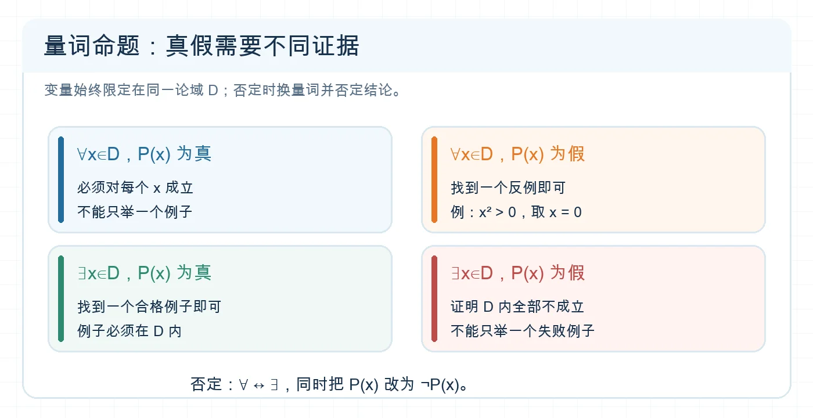

# 判断量词命题与写出否定

## 专题定位

解决“任意/存在”命题的真假、否定与简单参数问题。核心是始终保留变量范围，并区分证明全称命题与证明存在命题所需的证据。

## 1 分钟自测

写出“任意实数 $x$，$x^2>0$”的否定，并判断原命题真假。若写成“任意实数 $x$，$x^2\le0$”，说明只改了结论、忘了改量词。

**自测核对：** 否定为“存在实数 $x$，$x^2\le0$”；原命题是假命题，反例为 $x=0$。

## 必备知识与知识网络

| 命题 | 为真需要 | 为假只需 | 否定 |
| --- | --- | --- | --- |
| $\forall x\in D,\ P(x)$ | 对 $D$ 中每个 $x$ 都成立 | 找一个 $x\in D$ 使 $P(x)$ 假 | $\exists x\in D,\ \neg P(x)$ |
| $\exists x\in D,\ P(x)$ | 找一个 $x\in D$ 使 $P(x)$ 真 | 证明 $D$ 中每个 $x$ 都不成立 | $\forall x\in D,\ \neg P(x)$ |

常用结论的否定：$>$ 的否定是 $\le$，$\ge$ 的否定是 $<$，$=$ 的否定是 $\ne$。量词可能被省略，如“实数的平方非负”通常指“对任意实数”。先补全再否定。

```text
辨认论域与量词 → 找准结论 P(x) → 判断真假所需证据 → 否定时换量词并否定结论 → 检查范围不变
```


<!-- 图片描述：四格对比全称命题为真、全称命题为假、存在命题为真、存在命题为假各需要的证据；突出“全称为假只需一个反例”“存在为真只需一个例子”，底部写否定时 ∀ 与 ∃ 互换且 P(x) 改为 ¬P(x)。白色浅网格背景、深蓝文字、橙色突出反例。 -->

**读图提示：** “一个例子”能证明存在命题为真，却不能证明全称命题为真；否定时论域 $D$ 保持不变。

## 识题信号与解题步骤

| 题目出现 | 方法 |
| --- | --- |
| “任意”“所有”“每一个” | 当作全称命题；判假优先找边界、零或反例。 |
| “存在”“至少一个”“有些” | 当作存在命题；判真只需给出一个合法例子。 |
| “恒成立” | 通常转成“对论域中任意 $x$”；求参数时研究最小值或最大值。 |
| “有解” | 通常转成“存在论域中的 $x$”；求参数时看函数值域是否与目标相交。 |

## 例题精讲

**例 1｜真假与否定。** 原命题“$\forall x\in\mathbb R,\ x^2>0$”是假命题，因为 $x=0$ 时不成立。否定为“$\exists x\in\mathbb R,\ x^2\le0$”，它是真命题，证人就是 $x=0$。论域没有变化；量词和不等号都变了。

**例 2｜恒成立参数。** 求使“$\forall x\in\mathbb R,\ x^2+2x+a\ge0$”成立的 $a$。配方得 $x^2+2x+a=(x+1)^2+a-1$，其最小值为 $a-1$，故须且只须 $a\ge1$。这里“任意”要求整个定义域都非负，不能只代一个 $x$ 判断为真。

## 易错反例

- “有些人会做”的否定是“所有人都不会做”，不是“有些人不会做”。后者可能与原命题同时为真。
- 否定 $x\ge0$ 应写 $x<0$，不能写 $x\le0$；等号所在一边要核对。
- “存在 $x$ 使 $P(x)$”的例子必须在指定论域内。若论域是 $[0,1]$，$x=2$ 不能作证人。

## 考法总结

先把自然语言写成 $\forall/\exists$ 形式，再决定用证明、反例、最值或值域。含两个或更多量词时，否定要逐个改变量词并否定末端结论，且注意量词顺序；本篇练习先掌握单量词情形。

## 专题练习

1. **概念检查：** 写出“$\exists x\in\mathbb R,\ x^2<0$”的否定，并判断原命题真假。
2. **方法应用：** 求使“$\exists x\in[0,1],\ x>a$”为真的实数 $a$。
3. **进阶迁移：** 求使“$\forall x\in[0,1],\ x^2+a>0$”为真的实数 $a$，并写出该命题的否定。

## 练习答案与解析

1. 否定为“$\forall x\in\mathbb R,\ x^2\ge0$”，是真命题；原命题是假命题。
2. $[0,1]$ 中最大的 $x$ 为 $1$，存在 $x>a$ 当且仅当 $a<1$；$a=1$ 时无解。
3. $x^2$ 在 $[0,1]$ 上的最小值为 $0$，故 $a>0$。否定为“$\exists x\in[0,1],\ x^2+a\le0$”。

## 继续学习

- 前置详解：[[1.5-全称量词与存在量词]]
- 相关专题：[[05-判断充分必要条件]]
- 返回导航：[[00-学习导航]]
