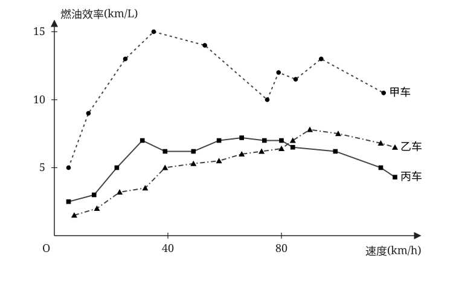

# 高一数学10月诊断练习：逐题解题思路

本文件对应[原练习](高一数学_10月诊断练习.md)的第 1—21 题。每题完整保留原题与选项，随后按条件、转化、分类和检验逐层展开解题思路；思路中不指出正确选项，也不写填空结果、最终参数范围、最值或存在性结论。可以先独立作答，再用“关键突破口”和“思维总结”检查自己是否抓住题眼。

> 第 18 题“其他成本”处的原卷照片被手写字迹遮挡；以下按现有题面中的 $2x$ 讨论方法。若取得更清晰的原卷，应先核对这一条件。

## 一、选择题

### 第 1 题｜含量词命题的否定

#### 原题

命题“对任意的 $x>0$，$x^3-x^2+1\leq 0$”的否定是（　　）

A. $\exists x>0,\ x^3-x^2+1>0$  
B. $\exists x\leq 0,\ x^3-x^2+1>0$  
C. $\forall x>0,\ x^3-x^2+1>0$  
D. $\forall x\leq 0,\ x^3-x^2+1>0$

#### 解题思路

- 题型识别：这是“全称命题的否定”，核心不是计算三次函数的正负，而是把原句拆成量词、论域和断言三层。量词是“对任意”，论域是 $x>0$，断言是 $x^3-x^2+1\leq0$。题目给出的选项正是围绕这三层分别制造变化。
- 关键突破口：否定“论域内每一个 $x$ 都满足断言”，只需说“论域内至少有一个 $x$ 不满足断言”。因此量词必须变，断言的不等号必须变，但 $x>0$ 只是讨论范围，不能随之变为 $x\leq0$。先把这三件事分开，就不用研究三次式的图象。
- 最优解法：第一步在原句中分别圈出“任意”“$x>0$”“$\leq0$”。第二步把前者改写成“存在某个”，原封不动保留 $x>0$。第三步只对结论取反：对 $P\leq0$，不满足 $P\leq0$ 的情形是什么。第四步逐项检查选项的量词、论域、符号；任何一层错都立即排除，不必验算函数值。
- 思维总结：形成固定模板：“否定全称命题＝同一论域内找一个反例”。先判选项是否仍在同一论域，再看谓词是否真正互否；不要把“不是小于等于”误写为“小于”。
- 其他解法：也可从每个选项出发，尝试用具体 $x$ 检验其真假；但题目问的是逻辑否定，某个命题碰巧为真并不代表它是原命题的否定。按量词规则处理更短，也能适用于没有具体函数式的题。
- 巩固加强：先练 $P\leq0$、$P>0$ 等成对的互否关系，再练 $\forall x\in D$ 与 $\exists x\in D$ 的互换；最后做“论域写在条件中”的题，特别检查否定时论域是否被错误改动。

### 第 2 题｜绝对值不等式、二次不等式与集合差

#### 原题

已知集合 $A=\{x\,|\,|x-1|<3\}$，$B=\{x\,|\,x^2-3x-10<0\}$，若 $a\notin A$，且 $a\in B$，则 $a$ 的取值范围是（　　）

A. $(-2,4)$  
B. $(4,5)$  
C. $[4,5]$  
D. $[4,5)$

#### 解题思路

- 题型识别：这是“解两个不等式，再做集合差”的复合题。$A$ 由绝对值不等式给出，$B$ 由二次不等式给出；最后的“$a\notin A$ 且 $a\in B$”才决定保留哪段。先分清集合归属，比先算区间更重要。
- 关键突破口：把文字先写成 $a\in B\setminus A$。随后分别处理两条边界：$|x-1|<3$ 对应以 $1$ 为中心的开区间；$x^2-3x-10<0$ 需要找两个零点并取抛物线在横轴下方的部分。两处都是严格不等式，但做差后，$A$ 的边界点可能重新被保留。
- 最优解法：第一步把 $|x-1|<3$ 写成 $-3<x-1<3$，再整体平移。第二步因式分解 $x^2-3x-10$，画出两个根及其间的负值区间。第三步把 $A,B$ 标在同一条数轴，不要在脑中直接做区间运算。第四步沿着 $B$ 从左到右删除落在 $A$ 内的点；在每个临界点单独代回“属于 $B$、不属于 $A$”两项，最后才选择区间表示。
- 思维总结：一见“属于 $B$ 而不属于 $A$”，先写 $B\setminus A$；一见严格不等式与集合差，特别检查被减集合的边界是否应保留。
- 其他解法：可直接解“$x^2-3x-10<0$ 且 $|x-1|\geq3$”这个联立不等式，把绝对值条件拆成两支。它不依赖画图，但分支和端点符号更多；数轴法更适合考试核对。
- 巩固加强：依次复习绝对值不等式的双边形式、二次三项式的因式分解与符号表、集合交差的定义；最后专练“严格不等式产生的边界在取差后是否留下”。

### 第 3 题｜同一函数的判定

#### 原题

下列各组函数表示同一函数的是（　　）

A. $f(x)=x$，$g(x)=\sqrt{x^{2}}$

B. $f(x)=|x-1|$；$g(x)$ 在 $x>1$ 时为 $x-1$，在 $x<1$ 时为 $1-x$

C. $f(x)=x+1$，$g(x)=\dfrac{x^{2}-1}{x-1}$

D. $f(x)=\dfrac{x^{0}}{x}$，$g(x)=\dfrac{x}{x^{2}}$

#### 解题思路

- 题型识别：“两式是否表示同一函数”有两道门槛：定义域相同，以及定义域内每个输入的输出相同。四组式子分别涉及 $\sqrt{x^2}$、分段端点、约分前的分母、零次幂的定义条件，不能只看外形。
- 关键突破口：优先比较原式定义域，因为定义域不同可以立刻否定“同一函数”；只有定义域相同才值得继续比较函数值。特别是 $\sqrt{x^2}$ 应按绝对值理解，分段式要看分界点是否有定义，分式不能在约分后把原本禁止的点补回来。
- 最优解法：先建立一个四行检查表，每行写两式各自允许的 $x$。对 A，比较负数输入时根式与一次式的输出；对 B，核查分段条件是否覆盖分界点；对 C，约分之前先记下分母的禁值；对 D，分别从 $x^0$、$1/x$、$x/x^2$ 的原式条件出发，再比较化简结果。只要发现定义域不同或找到一个输出不同的合法输入，就排除该组；余下组还需确认“处处相同”。
- 思维总结：把“同一函数”背成“同域、同值”。根式先想绝对值，分段先想端点，约分先想禁值；一个反例可以证伪，但多个相同样本不能证明相同。
- 其他解法：画图或代入特殊值能快速找出某些差异，但图象容易漏掉孤立缺点；逐式记录定义域，再做代数化简，是最稳的证明方式。
- 巩固加强：先练 $\sqrt{x^2}=|x|$ 和零次幂的适用条件，再练分式约分不改变原定义域、分段端点归属，最后用“同域同值”逐项判断混合题。

### 第 4 题｜由函数值表反推参数与复合函数

#### 原题

已知函数 $f(x)=x^2-1$，$g(x)=(x+1)^2$，下列表中 $x=m$ 时各函数的值，则（　　）

| $x$ | $f(x)$ | $g(x)$ | $f[g(x)]$ |
| :-: | :----: | :----: | :-------: |
| $m$ |   $8$  |   $4$  |    $n$    |

A. $m=3,\ n=15$  
B. $m=-3,\ n=15$  
C. $m=3,\ n=81$  
D. $m=-3,\ n=81$

#### 解题思路

- 题型识别：这道题把“由函数值反推输入”和“复合函数按顺序求值”放在一张表里。表格中的 $m$ 是同一个输入，$8$ 和 $4$ 分别来自两个函数；$n$ 是另一次函数计算的结果。
- 关键突破口：先不要急着算 $n$。由 $f(m)=8$ 得到的是一组候选，由 $g(m)=4$ 又得到一组候选，真正的 $m$ 必须同时在两组中。确定输入后，$f[g(m)]$ 的方括号表示“先算 $g(m)$，再把这个输出送入 $f$”。
- 最优解法：第一步依表格列 $m^2-1=8$，不要见到平方就只取正值。第二步另列 $(m+1)^2=4$，也保留两个平方根方向。第三步比较两组候选，逐个代回两条原式，留下共同满足者。第四步直接从表中读取 $g(m)$ 的值，将它当作 $f$ 的自变量求 $n$；最后一次性与选项核对。
- 思维总结：看到“同一个未知数满足两个函数值”，先求候选交集；看到 $f[g(m)]$，从内向外读。表格若已给出内层值，别重复计算。
- 其他解法：利用四个选项先筛 $m$、再筛 $n$ 可以很快，但容易在选项有相同 $m$ 或相同 $n$ 时混淆。列方程再做交集的流程对无选项题也适用。
- 巩固加强：先练平方方程的双根，再练“两个方程共用同一未知数”的筛选，最后练 $f(g(x))$ 与 $g(f(x))$ 的顺序辨析。

### 第 5 题｜代数式比较与恒成立判断

#### 原题

已知 $m>n>0$，则（　　）

A. $m\sqrt{n}<n\sqrt{m}$  
B. $m+n>mn$  
C. $\left(\dfrac{m+n}{2}\right)^2>\dfrac{m^2+n^2}{2}$  
D. $\dfrac{n}{m}+\dfrac{m}{n}>2$

#### 解题思路

- 题型识别：这是“在 $m>n>0$ 下判断哪个断言恒真”的题。四个选项分别要求根式比较、和积比较、两个平均数比较、互为倒数的比值比较；不能用一个公式机械处理全部。
- 关键突破口：先问每个比较的差值能否定号。A 可利用两边共同的 $\sqrt{mn}>0$ 化简，再回到 $m$ 与 $n$ 的已知次序；B 没有规定和或积固定，应警惕它随取值改变；C 展开后差值与 $(m-n)^2$ 有关；D 可通分，把分子整理为平方。严格不等号还要求检查等号是否可能。
- 最优解法：按“正性—变形—判号”逐项推进。对含根号式，先确认共同因子为正再同除；对和积式，试一组小正数及一组较大正数，判断是否能恒真；对均值式，两边通分并作差；对分式式，利用 $mn>0$ 通分。每完成一项，都回看推导中的不等号方向和 $m\ne n$ 是否足以保证严格性。
- 思维总结：选择题问“必然成立”时，证明真的选项要有可判号的式子，否定假的选项只需合法反例。$m>n>0$ 给了正性与不相等性，两者都要用上。
- 其他解法：基本不等式可快速处理均值或互为倒数的形式，但等号条件必须一并说明；作差／通分虽然多一行，却能把结论直接落在平方项上，方向更不易错。
- 巩固加强：先练正因子同除、同乘与不等号方向，再练作差比较和 $(m-n)^2$ 的使用，最后练基本不等式的成立条件、等号条件与反例构造。

### 第 6 题｜折线图阅读与燃油效率

#### 原题

汽车的“燃油效率”是指汽车每消耗 $1$ 升汽油行驶的里程．如图描绘了甲、乙、丙三辆汽车在不同速度下的燃油效率情况，下列叙述中正确的是（　　）

A. 消耗 $1$ 升汽油，乙车最多可行驶 $5$ 千米  
B. 某城市机动车最高限速 $80$ 千米/时，相同条件下，在该市用丙车比用乙车更省油  
C. 甲车以 $80$ 千米/时的速度行驶 $1$ 小时，消耗 $10$ 升汽油  
D. 以相同速度行驶相同路程，三辆车中，甲车消耗汽油最多

#### 解题思路

- 题型识别：这是带单位的统计图判断题，重点不在复杂计算，而在图例、横轴速度、纵轴燃油效率与文字说法的对应。四个选项分别用了“最多”“限速范围内更省油”“行驶一小时耗油”“同速同路程比较”，量词和比较范围各不相同。
- 关键突破口：图中的纵轴单位是 km/L，含义是每升油能走的路程，数值越大通常越省油。要比较相同路程的耗油量，应使用“耗油量＝路程÷燃油效率”。最高限速只限制可比较的速度范围；“最多”则要在相应车辆整条曲线上找最高点。
- 最优解法：先对照图例确认三条曲线的身份，在横轴上标出选项提到的速度与限速边界。检查 A 时只沿乙车曲线找峰值；检查 B 时只看限速以内的丙、乙相对高低，注意“在该市”是否意味着所有可行速度；检查 C 时先由速度×时间得到路程，再从甲车曲线读效率，套上耗油量公式；检查 D 时固定相同速度和路程，比较三条曲线中谁的效率最低。最后只用图示数据作判断，不把手写批注当作题目条件。
- 思维总结：图表题固定顺序是“认图例→认轴与单位→锁定量词范围→转换为公式→核对每个说法”。遇到“越省油”，先确认纵轴是效率还是耗油量，避免方向颠倒。
- 其他解法：所有选项都逐点换算成升数也能判断，但会增加读数误差；能比较曲线相对高度时，先作定性判断，仅在选项给出具体升数时计算。
- 巩固加强：先练速度、时间、路程的单位关系，再练比率单位 km/L 与 L/km 的倒数意义，最后练带“最多”“始终”“某一速度”等不同量词的图象判断。

### 第 7 题｜充分必要条件与基本不等式

#### 原题

若 $a>0,\ b>0$，则“$a+b\leq 4$”是“$ab\leq 4$”的（　　）

A. 充分不必要条件  
B. 必要不充分条件  
C. 充分必要条件  
D. 既不充分也不必要条件

#### 解题思路

- 题型识别：这是判断条件关系的双向蕴含题。设 $P$ 为“$a+b\leq4$”，$Q$ 为“$ab\leq4$”，并始终保留 $a,b>0$。选“充分”“必要”前，必须分别验证 $P\Rightarrow Q$ 与 $Q\Rightarrow P$。
- 关键突破口：正数的和能通过 $ab\leq((a+b)/2)^2$ 控制积，因此一个方向可直接证明。反方向只控制积，允许一数大、一数小；这提示用极端但仍为正的数试反例，检查和是否还能受控。
- 最优解法：第一步写两支箭头，明确哪支对应充分、哪支对应必要。第二步在 $P$ 条件下套 $ab\leq((a+b)/2)^2$，再利用给定和的上界，不跳过正性和平方可比较这两点。第三步在 $Q$ 条件下令其中一个正数变大、另一个变小且保持积符合要求，检验是否能违反 $P$。第四步根据“证明一支、反例否定另一支”的记录对应到选项。
- 思维总结：条件判断题不要凭直觉选“充分必要”；先画 $P\to Q$、$Q\to P$ 两个箭头。和与积同现时，先想均值不等式，逆向再想一大一小的正数。
- 其他解法：在第一象限画出 $a+b=4$ 与 $ab=4$ 的边界，再看两个区域的包含关系，能建立直观；但边界及严格性易看错，代数证明加反例更适合考试。
- 巩固加强：先练充分、必要与箭头的互译，再练基本不等式及等号条件，最后练“一个方向给证明，另一个方向给反例”的完整书写。

### 第 8 题｜海伦—秦九韶公式与面积最值

#### 原题

中国南宋大数学家秦九韶提出了“三斜求积术”，即已知三角形三边长求三角形面积的公式：设三角形的三条边长分别为 $a,\ b,\ c$，则三角形的面积 $S$ 可由公式 $S=\sqrt{p(p-a)(p-b)(p-c)}$ 求得，其中 $p$ 为三角形周长的一半，这个公式也被称为海伦—秦九韶公式．现有一个三角形的边长满足 $a=4$，$b+c=6$，则此三角形面积的最大值为（　　）

A. $3\sqrt{5}$  
B. $2\sqrt{5}$  
C. $2\sqrt{6}$  
D. $3\sqrt{6}$

#### 解题思路

- 题型识别：这是“固定一边、另外两边的和固定”的三角形面积最值题。题目已给海伦—秦九韶公式，重点不是背公式，而是看公式里哪些因子固定、哪些因子可变，以及取等时三角形是否真实存在。
- 关键突破口：由 $a=4$、$b+c=6$ 可知半周长 $p$ 已固定，因此 $p$ 与 $p-a$ 都是常数。余下 $p-b$、$p-c$ 随两边变化，但它们的和由 $2p-(b+c)$ 固定。最大面积转化成“固定和的两个正数，其乘积何时最大”。
- 最优解法：先写 $S^2=p(p-a)(p-b)(p-c)$，避免一开始就带根号比较。把前两个固定因子合在一起，令 $u=p-b$、$v=p-c$，从边长和求出 $u+v$，并由三角形不等式确认 $u,v>0$。对 $uv$ 用基本不等式求上界，再把取等条件 $u=v$ 还原为 $b,c$ 的关系。最后回验三边能组成三角形，并在选项中匹配面积表达式；不要只停留在面积平方。
- 思维总结：海伦公式求最值，固定半周长后优先看剩余两个因子的定和关系；“算出上界”与“能取到上界”是两件事，必须验边长。
- 其他解法：用固定底边 $a$ 和余下边长之和，结合几何对称性，可猜测等腰构型；但要严格证明面积最大仍需不等式或配方。令 $b$ 为变量并把 $c$ 用 $6-b$ 替换，也可配方求极值，步骤更长。
- 巩固加强：先练半周长与三角形不等式，再练定和两正数乘积最大及等号条件，最后练“先对面积平方优化、再还原面积”的流程。

### 第 9 题｜含参数不等式的整数解个数

#### 原题

已知关于 $x$ 的不等式 $a(x^2-x)+1<x^2$ 恰有一个整数解，则 $a$ 的取值范围是（　　）

A. $\dfrac{4}{3}\leq a<\dfrac{3}{2}$  
B. $\dfrac{4}{3}<a\leq\dfrac{3}{2}$  
C. $\dfrac{4}{3}\leq a<2$  
D. $\dfrac{4}{3}\leq a<\dfrac{3}{2}$ 或 $a<0$

#### 解题思路

- 题型识别：这是含参数不等式与“整数解恰好一个”的结合题。需要先找实数解区间，再看该区间覆盖多少整数；参数还会改变二次项系数和两个根的位置，不能直接套固定开口的结论。
- 关键突破口：移项后可以整理为 $(x-1)[(a-1)x-1]<0$。其中 $x=1$ 是固定零点，另一个零点随 $a$ 移动。严格不等式使零点本身不算解；“恰有一个整数”就是活动零点刚好越过第一个候选整数、尚未越过第二个候选整数。
- 最优解法：先因式分解，不展开求根公式。单独处理 $a=1$，避免在后续求活动零点时除以零。再按 $a-1$ 的正负，画两因子的符号表，判断实数解是两根之间还是外侧；外侧若延伸到无穷远，要立即检查整数解是否会无限多。对可能只含有限整数的区间，以固定根 $1$ 为锚点，先找紧邻它的候选整数，写“此整数严格落入、再相邻的整数不落入”的两条条件。最后代回临界参数检查端点的取舍。
- 思维总结：看到“恰有一个整数解”，先画数轴整数格点，再看活动根在哪两个相邻格点之间；严格号决定边界等号取舍，退化参数要单列。
- 其他解法：完整写出每一类实数解集，再利用取整函数计数更通用，但对本题会增加符号和端点分类。选项代入临界参数可以辅助核对开闭，却不能代替区间计数的证明。
- 巩固加强：先练乘积不等式符号表、参数使二次式退化的情形，再练开区间内整数个数，最后练“一个整数进入、下一个还未进入”的临界值分析。

### 第 10 题｜集合特征函数

#### 原题

对于全集 $U$ 的子集 $A$，定义函数 $f_A(x)$：当 $x\in A$ 时，$f_A(x)=1$；当 $x\in\complement_U A$ 时，$f_A(x)=0$．称其为 $A$ 的特征函数．设 $A,B$ 为全集 $U$ 的子集，下列结论中错误的是（　　）

A. 若 $A\subseteq B$，则 $f_A(x)\leq f_B(x)$  
B. $f_{\complement_U A}(x)=1-f_A(x)$  
C. $f_{A\cap B}(x)=f_A(x)\cdot f_B(x)$  
D. $f_{A\cup B}(x)=f_A(x)+f_B(x)$

#### 解题思路

- 题型识别：题目把集合成员关系编码成 $0$ 或 $1$，要求检查子集、补集、交集、并集对应的函数式。它本质上是“元素是否属于集合”的逻辑题，而不是通常意义上的函数图象题。
- 关键突破口：固定一个 $x$，它对 $A,B$ 只有四种归属：都不在、只在 $A$、只在 $B$、两者都在。尤其“两者都在”会暴露把并集直接当作两个特征函数相加时的重复计数问题。
- 最优解法：先画两列 $f_A(x),f_B(x)$，列出 $(0,0),(1,0),(0,1),(1,1)$ 四行。对 A，利用 $A\subseteq B$ 意味着“不可能出现只在 $A$”的那一行；对 B，比较成员身份取反前后的 $0/1$；对 C，检查只有两者均为 $1$ 时交集函数才为 $1$；对 D，重点把 $(1,1)$ 代到等号两端。每个式子必须对所有允许状态都成立，发现一个反例状态即可停止。
- 思维总结：集合特征函数的口诀是“交看同时、补看翻转、并看至少一个”；遇到加法公式，首先测试重叠元素，因为普通加法会重复计数。
- 其他解法：记住交、补、并的代数公式可快速判断，但在“并”项最容易漏掉交集修正项。四格真值表不靠记忆，四行就能把每个式子验完。
- 巩固加强：先练集合成员关系的四种状态，再练子集、交、并、补的逐元素定义，最后练 $0/1$ 特征函数的乘法与相加何时有效。

## 二、填空题

### 第 11 题｜实数全集中的补集

#### 原题

已知 $U=\mathbb{R}$，集合 $A=[0,+\infty)$，则 $\complement_U A=$ \_______\_．

#### 解题思路

- 题型识别：这是全集为实数集时，求单个射线区间的补集。计算很短，但常见失误是忘记全集、把无穷端写成方括号，或把原集合已经包含的边界点再写入补集。
- 关键突破口：$A=[0,+\infty)$ 表示从边界点开始向右的所有实数，且左端点被包含。补集的定义是“在 $\mathbb R$ 中，但不在 $A$ 中”；因此只需反向看数轴左侧，并核对边界点归谁。
- 最优解法：先把实数轴画一条线，在边界点画实心点并向右涂色表示 $A$。再取未涂色部分作为 $\complement_U A$，写区间时检查左端的无穷符号和右端边界的开闭。最后做双向检验：任取补集内一点应不在 $A$；原集合的边界点不应同时出现。
- 思维总结：求补集先锁定全集，再把“属于原集合”改成“不属于原集合”；端点的归属由原集合的括号决定，而不是凭方向猜。
- 其他解法：由 $x\in A$ 等价于 $x\geq0$，直接对不等式取否定也很快；数轴法更能避免端点漏看，在多个区间的补集题中也更通用。
- 巩固加强：先练 $[,]$ 与 $(,)$ 的端点含义、无穷端只能用圆括号，再练半无限区间和多个区间在指定全集中的补集。

### 第 12 题｜根式与分式共同限定定义域

#### 原题

函数 $f(x)=\sqrt{\dfrac{x-2}{x+1}}$ 的定义域是 \_______\_．

#### 解题思路

- 题型识别：这不是单独的根式定义域，也不是单独的分式定义域；平方根要求“整个分式非负”，分母还必须不为零。两个条件要同时成立。
- 关键突破口：$\sqrt{(x-2)/(x+1)}$ 的被开方数是一个整体。分式非负可以来自“分子分母同正”或“分子分母同负”，所以分别要求 $x-2\geq0$、$x+1>0$ 会漏掉一段；直接两边同乘 $x+1$ 又可能因其符号改变不等号方向。
- 最优解法：先写 $\dfrac{x-2}{x+1}\geq0$ 与 $x+1\ne0$。在数轴上按分子零点 $x=2$ 和分母零点 $x=-1$ 分成三段，每段取一个试验点判断比值正负。对可行段再核查：分子为零时根号是否允许；分母为零时无论符号表怎样都必须删掉。最后用区间并集表达，而不是把不相连的部分连成一段。
- 思维总结：看到“根号套分式”，立刻写“整体非负＋分母非零”；分子零点可考虑保留，分母零点绝不能保留。
- 其他解法：先写“分子分母同号”分两类联立，也能求域，但不等号容易在分子等于零时出错。数轴符号表只需三段，通常更快、更稳。
- 巩固加强：先练平方根的非负条件，再练分式符号表和零点、禁点的区别，最后练多个定义域约束同时出现时的交集。

### 第 13 题｜分段函数的复合求值与方程

#### 原题

函数 $f(x)$ 在 $x\leq-1$ 时为 $x+2$，在 $x>-1$ 时为 $x^2$．则 $f\bigl(f(-2)\bigr)=$ \_______\_；若 $f(x)=3$，则 $x=$ \_______\_．

#### 解题思路

- 题型识别：一道题里有两个不同任务：求复合函数值，以及求分段函数方程的解。前者考查每层输入重新判段，后者考查“在某段列式所得的根是否真的落在该段”。
- 关键突破口：计算 $f(f(-2))$ 时，先输入 $-2$，得到的函数值成为外层的新输入；不能因内层用了 $x\leq-1$ 一段，就默认外层也用这一段。求 $f(x)=3$ 时，两段都可能提供候选，但每段带着自己的定义范围。
- 最优解法：对第一空，先看 $-2$ 与分界点 $-1$ 的位置，用对应表达式求内层值；在纸上画箭头“$-2\to f(-2)\to f(f(-2))$”，中间值出来后重新与 $-1$ 比较，才选外层表达式。对第二空，分别写“$x\leq-1$ 且 $x+2=3$”与“$x>-1$ 且 $x^2=3$”；每支先求候选，再用该支的不等式逐一筛选，最后合并有效候选。
- 思维总结：分段函数的纪律是“每代入一次，重新判段一次；每解出一个根，回原区间验一次”。边界等号属于哪段，直接看题中条件。
- 其他解法：画分段图象并观察与 $y=3$ 的交点可辅助核对，但精确填空仍需要代数判断；机械地直接代入同一个分支虽然快，却最容易错在外层输入和越界根。
- 巩固加强：先练分段区间的端点归属，再练两层复合求值，最后练“方程候选根与分支条件”取交集的题。

### 第 14 题｜集合交集“恰好为”与元素互异性

#### 原题

设集合 $A=\{a,\ |a|,\ a^2\}$，$B=\{2,4\}$，若 $A\cap B=\{2\}$，则实数 $a$ 的值为 \_______\_．

#### 解题思路

- 题型识别：这是利用指定交集反推参数的题，集合 $A$ 中三个表达式可能取到相同数，因此还要注意集合不重复计数。交集写成单元素集合，比“某数属于交集”多了一条排除要求。
- 关键突破口：$A\cap\{2,4\}=\{2\}$ 可拆成“$2$ 必须在 $A$ 中”与“$4$ 必须不在 $A$ 中”。前一条产生候选，后一条负责筛候选。$2\in A$ 可能来自 $a=2$、$|a|=2$ 或 $a^2=2$ 三条来源，不能只看第一项。
- 最优解法：先把“$2\in A$”拆成上述三个方程，分别求候选参数并合并去重。对每一个候选，把 $a,|a|,a^2$ 的三个取值列出来，检查其中有没有 $4$；若有，就不满足“交集恰好只有 $2$”。最后再确认 $2$ 的确出现，并把有效参数作为一个集合处理，不因同一个参数由两条来源得到而重复写。
- 思维总结：凡题目说“交集恰好是某集合”，先同时写“需要包含哪些元素”和“必须排除哪些元素”。先产候选、后排多余元素，是最稳的两阶段法。
- 其他解法：按 $a$ 的正负分类直接计算集合 $A$，也能覆盖可能性，但 $a^2=2$ 一类不容易凭直觉想到。按“目标元素从哪一项产生”列方程更系统。
- 巩固加强：先练集合元素的互异性、绝对值和平方方程，再练“至少含有”与“恰好等于”的逻辑差别，最后练指定交集的候选生成与排除。

### 第 15 题｜用反例否定不等式命题

#### 原题

已知 $a,\ b,\ c$ 为实数，能说明“若 $a>b>c$，则 $a^2>bc$”为假命题的一组 $a,\ b,\ c$ 的值是 \_______\_．

#### 解题思路

- 题型识别：这是“用一组实数证伪全称命题”的开放填空。要否定“若 $a>b>c$，则 $a^2>bc$”，所找的三元组必须同时满足前件，并使后件失败；只满足其中一个条件不能算反例。
- 关键突破口：题目只说实数，没有正数限制。若选三个正数，顺序关系常使平方与乘积不易逆转；改试三个负数时，虽然 $a>b>c$，但它们的绝对值次序相反。此时 $b,c$ 的乘积为正，且可能比 $a^2$ 大，方向就出现突破。
- 最优解法：先把目标写成“$a>b>c$ 且 $a^2\leq bc$”，这样目标明确。接着选择易比较的有序负整数，使 $|a|<|b|<|c|$；不必寻找复杂分数。选定后做两次独立验算：先按原顺序核查 $a>b>c$，再分别算 $a^2$ 与 $bc$，确认后件确实不成立。最后只填一组符合两项检查的值。
- 思维总结：举反例先把命题的否定写成“前件真、后件假”。条件为“实数”时，不要默认正数；符号改变通常是构造不等式反例的第一突破口。
- 其他解法：可以设 $a=-u,b=-v,c=-w$，把条件转为 $0<u<v<w$，再分析 $u^2$ 与 $vw$；这种参数化更有解释力，但题目只要一组具体值，直接取易算整数更省时。
- 巩固加强：先练“若 $P$ 则 $Q$”的否定与反例两项检验，再练负数大小顺序和平方、乘积的比较，最后练开放填空中如何选择计算量小的数。

### 第 16 题｜有限集合划分与基数限制

#### 原题

已知非空集合 $A$，$B$ 同时满足以下四个条件：

1. $A\cup B=\{1,2,3,4,5\}$；
2. $A\cap B=\varnothing$；
3. $card(A)\notin A$；
4. $card(B)\notin B$．

注：其中 $card(A)$，$card(B)$ 分别表示 $A$，$B$ 中元素的个数．

如果集合 $A$ 中只有一个元素，那么 $A=$ \_______\_；

如果集合 $A$ 中有 $2$ 个元素，请写出所有满足条件的集合 $A$：\_______\_．

#### 解题思路

- 题型识别：这是一道有限全集划分题，且“集合的元素个数”本身又作为某个数字参与成员判断。四项条件不是彼此独立的：并集与空交集先确定 $A,B$ 是互补关系，基数限制再强制某些数字的归属。
- 关键突破口：令 $U=\{1,2,3,4,5\}$，由前两项得 $B=U\setminus A$ 和 $card(B)=5-card(A)$。因此 $card(A)\notin A$ 等价于数字 $card(A)$ 必须在 $B$；$card(B)\notin B$ 等价于数字 $card(B)$ 必须在 $A$。把“不属于自己”转成“属于对方”，枚举量立刻下降。
- 最优解法：第一问先设 $card(A)=1$，随即确定 $card(B)$；把两项基数条件转为两枚具体数字的归属，再结合 $A$ 只能含一个元素，检查是否唯一。第二问设 $card(A)=2$，同样锁定 $card(B)$ 及两个数字分别必须放在哪边；在剩余三个数字中为 $A$ 选择其余位置。枚举后逐个构造补集 $B$，回验非空、并集、空交集及两个基数禁入条件，避免漏写或多写。
- 思维总结：遇到“$card(A)\notin A$”，先别直接枚举 $A$，先问 $card(A)$ 是全集中的哪个数字、它必须去哪一个集合。互补划分题先转归属，后枚举。
- 其他解法：从五个数字中直接枚举一元或二元子集，再逐项淘汰也可行；但枚举时容易忘记基数所指的数字会随着 $|A|$ 改变。强制归属法更清楚。
- 巩固加强：先练有限集的补集及元素个数关系，再练“基数是数，也可能是集合元素”的阅读能力，最后练先锁定必选元素再列全体候选。

## 三、解答题

### 第 17 题｜含参数集合与补集并集

#### 原题

已知集合 $A=\{x\,|\,x^2-ax+4>0\}$，$B=\{x\,|\,b+2<x<2b\}$．若 $1\in A$，$2\notin A$，则 $a$ 的取值集合为 $C$．

（1）求集合 $C$；

（2）若 $C\cup\complement_{\mathbb{R}}B\neq\mathbb{R}$，求实数 $b$ 的取值范围．

#### 解题思路

- 题型识别：第（1）问由指定元素的成员关系求参数集合，第（2）问由“某并集未覆盖全体实数”判定另一含参数开区间是否有遗漏点。两问依赖：先得到 $C$，后讨论 $B$ 相对 $C$ 的位置。
- 关键突破口：$A$ 用严格不等式定义，所以 $1\in A$ 对应代入后“$>0$”，而 $2\notin A$ 对应“$\leq0$”，不能也写成严格小于。第（2）问用集合逻辑改写：$C\cup\complement_{\mathbb R}B\ne\mathbb R$ 当且仅当存在 $x$ 同时属于 $B$、不属于 $C$，即 $B\setminus C\ne\varnothing$。
- 最优解法：先分别计算 $x=1$ 与 $x=2$ 时多项式的值，列出两个关于 $a$ 的不等式并取交，写出 $C$ 的区间及端点。再看 $B=(b+2,2b)$：只有左端小于右端时才有元素，空集要先排除。把 $B$ 和 $C$ 画在同一数轴，检查 $B$ 是否可能伸到 $C$ 左侧或右侧；对每种位置写“存在一个 $B$ 内而 $C$ 外的点”所需的端点关系。最后把位置条件与 $B$ 非空条件取交，并核对两集合端点一个开、一个可能闭的影响。
- 思维总结：看到“并集不等于全集”，立即找一个未覆盖的元素；若并集的一项是 $B$ 的补集，未覆盖点必在 $B\setminus C$。含参数开区间先验非空，再论相交或超出。
- 其他解法：用德摩根律写 $\complement(C\cup\complement B)=\complement C\cap B$，再要求交集非空，也完全等价；直接说“$B$ 中有点不在 $C$”更符合数轴直观。
- 巩固加强：先练严格不等式集合的“不属于”如何翻成非严格不等式，再练参数开区间的非空条件，最后练补集、并集与存在性命题互译。

### 第 18 题｜分段函数利润模型与全局最值

#### 原题

某农庄种植了多种农作物，调研发现：某种农作物单株的产量 $t$（单位：kg）与肥料成本 $x$（单位：元）满足如下关系：

- 当 $0\le x\le 3$ 时，$t(x)=\dfrac{x^2+40}{4}$；
- 当 $3<x\le 10$ 时，$t(x)=15-\dfrac{18}{x}$。

单株成熟除肥料成本 $x$（单位：元）外，还需其他成本 $2x$（单位：元）．已知这种农作物的市场售价为 $6$ 元/kg，且供不应求，记该农作物单株获得的利润为 $f(x)$（单位：元）．

（1）求 $f(x)$ 的函数关系式；

（2）当投入的单株肥料成本为多少元时，该农作物单株获得的利润最大？最大利润是多少元？

#### 解题思路

- 题型识别：这是实际情境中的分段函数建模与全局最值。第（1）问要把 kg、元/kg 和两项元成本对齐；第（2）问要在两个不同区间分别优化，最后再比较，不能只求一段的极值。
- 关键突破口：市场售价乘产量得到收入，再减去肥料成本 $x$ 和题面写出的其他成本 $2x$；因此两段都沿用同一模型“利润＝$6t(x)-x-2x$”。产量第一段含 $x^2$，利润会成为开口向上的二次式；第二段含 $1/x$，利润可看成常数减去 $px+q/x$。两段的求最大方法不同。
- 最优解法：先写统一利润模型，再分别代入两段 $t(x)$，保留 $0\leq x\leq3$ 与 $3<x\leq10$，不要只写一个不带区间的式子。第一段确认二次项系数的符号：开口向上的二次函数在闭区间上的最大值只需比较两端，并解释顶点给的是最小值。第二段把可变的减项整理为 $px+q/x$，由 $x>0$ 使用基本不等式求其下界；从等号条件求候选 $x$，再检查它是否真的落在 $(3,10]$。最后把两段能实际取到的最大利润并列比较，还要核查 $x=3$ 的归属与两段衔接处。
- 思维总结：分段利润题按“单位核对→建模→保留分段区间→各段求可取的最值→全局比较”推进。对闭区间开口向上的二次式看端点，对 $x+1/x$ 型先想基本不等式并验等号点。
- 其他解法：第二段也可分析函数单调性或学过导数后求导，方法通用，但当前题的 $px+q/x$ 结构让基本不等式更省步骤。第一段配方可看清顶点，却不能省去端点比较。
- 巩固加强：先练“售价×产量－全部成本”的单位模型，再练开口方向与闭区间端点最值，最后练正数 $px+q/x$ 的基本不等式、等号条件和跨分段比较。

### 第 19 题｜二次函数恒非负与含参数二次不等式

#### 原题

已知函数 $f(x)=ax^2+(a-2)x+\dfrac{1}{4}\ (a\in\mathbb{R})$．

（1）若关于 $x$ 的不等式 $f(x)\geq 0$ 的解集是实数集 $\mathbb{R}$，求 $a$ 的取值范围；

（2）当 $a<0$ 时，解关于 $x$ 的不等式 $f(x)-\dfrac{9}{4}\leq 0$．

#### 解题思路

- 题型识别：第（1）问是含参数多项式对所有实数恒非负；第（2）问已知 $a<0$，要解一个含参数二次不等式。第一问研究函数整体形状，第二问研究乘积符号，不能把同一套判别式机械用到底。
- 关键突破口：讨论“二次函数恒非负”前先看 $a$ 会不会等于零；一旦 $a=0$，函数退化为一次式，判别式规则便不能直接使用。真正的二次情形必须同时满足开口向上和没有两处穿过横轴。第二问把 $9/4$ 移到左边后，常数与中间项使式子容易因式分解，根的顺序会随 $a$ 改变。
- 最优解法：第（1）问先单列 $a=0$，直接看该一次式是否能对所有实数非负；再在 $a\ne0$ 时根据 $|x|$ 很大时的符号限定开口方向，计算判别式并要求它不使抛物线落到横轴下方。第（2）问先整理 $f(x)-9/4$ 并尝试写成两个一次因子的乘积；因 $a<0$，求出两个零点后先比较谁在左、谁在右，特别找出根重合的参数。最后画符号表，按原式“$\leq0$”决定根是否包含在解集中。
- 思维总结：恒成立先问“会不会降次”，再用开口与判别式；含参数不等式先因式分解、找根、排根序，最后看严格或非严格边界。
- 其他解法：第（1）问可配方求全局最小值，直观但仍要单列 $a=0$；第（2）问可画抛物线，开口和根序清楚，但不先比较含参数两根仍无法正确写区间。
- 巩固加强：先练二次函数最小值与判别式的关系，再练一次函数不可能无条件恒非负的判断，最后练含参数两根换序及重根情况下的符号表。

### 第 20 题｜恒等式定系数、闭区间最值、参数恒成立

#### 原题

已知二次函数 $f(x)=ax^2+bx+c\ (a\neq 0)$ 满足 $f(0)=1$，$f(x+1)-f(x)=2x$．

（1）求 $f(x)$ 的解析式；

（2）若函数 $g(x)=f(x)-kx$ 在区间 $[-1,2]$ 上的最小值为 $-3$，求实数 $k$ 的值；

（3）若对任意 $x\in[1,4]$，有不等式 $f(x)\geq (m+1)x^2-(2+m)x-1$ 恒成立，求实数 $m$ 的取值范围．

#### 解题思路

- 题型识别：本题三问递进：由函数值差确定二次函数，随后研究参数 $k$ 影响下的闭区间最小值，最后研究含参数 $m$ 的不等式对区间内所有 $x$ 成立。前一问得到的函数必须代入后两问，不能三问各做各的。
- 关键突破口：展开差式时，$f(x+1)-f(x)$ 的二次项会抵消，因而可比较一次项和常数项；$f(0)$ 再给出剩余系数。对 $g$，参数只改变对称轴位置，最小点可能是左端、顶点或右端。第（3）问的“任意 $x$”要求在整个闭区间找最严格的参数限制，其中使参数系数为零的端点必须单独检查。
- 最优解法：第（1）问先写 $f(x+1)-f(x)=2ax+(a+b)$，将它与题给 $2x$ 比较系数，再结合 $f(0)=c$；计算结果留作后续使用。第（2）问写 $g$ 的对称轴位置，将 $[-1,2]$ 分成“轴在左、轴在内、轴在右”三类：轴在内用顶点值，轴在外用靠近轴的端点值。每类由“最小值为 $-3$”求候选 $k$ 后，都回验轴所在的分类。第（3）问把已知 $f$ 代入并将含 $m$ 的项集中，先单看 $x=1$ 使系数为零时原不等式是否成立；对 $1<x\leq4$，在确认除数正负后整理成 $m$ 的上界，再求右侧函数在该区间内的最小值，最后核对端点可取性。
- 思维总结：三条操作链依次是“恒等式→比系数”“区间最值→定位对称轴”“对所有 $x$→找最不利点”。涉及除法时先查系数零点，涉及分类时每个候选都必须回验所属类别。
- 其他解法：第（2）问可分别算两个端点和顶点后作整体比较，但顶点落在区间外时它不是合法候选；第（3）问也可把两边相减看成关于 $x$ 的二次函数并逐类求最小值，分类较多，整理为 $m$ 的逐点上界通常更短。
- 巩固加强：先练函数值差展开、系数比较和配方，再练对称轴与闭区间三段分类，最后练“对任意 $x$ 成立”如何转成参数界及零系数端点特判。

### 第 21 题｜集合递推、不变量与逆向构造

#### 原题

给定正整数 $N\geq 3$，设集合 $A=\{a_i\,|\,a_i\in\mathbf{N}^*,\ i=1,2,\dots,N\}$．任取 $A$ 中两个元素 $a_i,\ a_j$，记 $A_1=\{a_i,a_j\}$，$B_1=\{a_i+a_j,\ a_ia_j\}$，$T_1(A)=B_1\cup C_A A_1$；任取 $T_1(A)$ 中两个元素 $a_k,\ a_l$，记 $A_2=\{a_k,a_l\}$，$B_2=\{a_k+a_l,\ a_ka_l\}$，$T_2(A)=B_2\cup C_{T_1(A)}A_2$；…，以此类推：任取 $T_{k-1}(A)$ 中两个元素 $a_u,\ a_v$，记 $A_k=\{a_u,a_v\}$，$B_k=\{a_u+a_v,\ a_ua_v\}$，$T_k(A)=B_k\cup C_{T_{k-1}(A)}A_k$，其中 $k\geq 1$，规定 $T_0(A)=A$．

（1）当 $A=\{3,5,7\}$ 时，写出一组 $A_1$，$B_1$ 和 $T_1(A)$；

（2）是否存在集合 $A$ 与正整数 $k$，使 $T_k(A)=\{17,37,77\}$？说明理由；

（3）当 $A=\{1,2,3,4,5\}$ 时，是否存在正整数 $k$，使 $T_k(A)=\{5,9,26,120,121\}$？若存在，写出一组 $T_1(A),\ T_2(A),\ \dots,\ T_k(A)$；若不存在，说明理由．

#### 解题思路

- 题型识别：这是一道集合操作与可达性题。每步从当前集合取两个不同元素，删除它们，再把“和、积”加入其余元素；结果仍是集合，所以新生成的数若与已有元素重合，要按集合规则去重。三问分别考查正向演示、性质排除、逆向构造。
- 关键突破口：操作的局部信息是“新生成的两个数必须是某对正整数的和与积”。若给出这两个新数 $s,p$，反推原数 $u,v$ 需要满足 $u+v=s$、$uv=p$，即成为 $z^2-sz+p=0$ 的两个正整数根。另一条强限制来自奇偶性：任意两个正整数的和与积，不可能同时都是奇数；因此若某目标集合所有元素都为奇数，要格外检查最后一步是否可能产生它。
- 最优解法：第（1）问任选一对易算的原元素，先写被删除的二元集合，再分别算和与积，与未删除元素作并集，注意去重。第（2）问暂不猜初始 $A$ 或步数，先只看最后一步：目标集合必须容纳最后生成的和与积；把目标元素的奇偶性与“和、积能否同时为奇数”的规则对照，给出覆盖全部可能操作的理由。第（3）问从目标集合里挑一对可能同为最后一步产物的数，按“和、积”代入二次方程，检查判别式是否为完全平方数、根是否为不同正整数；把找到的原数替换回去，逐层逆推，直到回到初始集合。逆推只是找线索，最终还要从 $\{1,2,3,4,5\}$ 正向逐步操作，逐行核对每个集合。
- 思维总结：递推可达性先问“每一步都不能违背什么性质”，如奇偶、元素个数、正整数性；排除不了时，再从目标反推可能的前一状态。证明不可能靠覆盖所有最后一步情形，证明可能靠一条完整的正向构造链。
- 其他解法：从起点枚举所有可取数对，适合前几步或用程序辅助发现规律，但分支数很快增加，而且集合重合会使状态数量变化。逆向用和积关系通常更有目标，找到候选后再正向验证即可。
- 巩固加强：先练集合去重与补集式删除，再练奇偶性及“和积反推两数”的一元二次方程，最后练不变量排除与正向构造的完整证明格式。

## 考场速查

| 题号范围 | 看到的信号 | 立即启动的动作 |
| --- | --- | --- |
| 1、7、15 | 否定、充分必要、假命题 | 保论域；双向检验；找合法反例 |
| 2、10、11、14、16、17、21 | 属于、交并补、元素个数 | 先翻译集合关系，再画数轴或枚举元素 |
| 3、4、12、13 | 同一函数、复合、分段、定义域 | 原式定义域先行；先内后外；候选回段 |
| 5、8、18 | 比较与最大值 | 查正数条件、等号点、区间端点 |
| 6 | 图象与单位 | 先读纵轴含义，再把文字转为数量关系 |
| 9、19、20 | 整数解、恒成立、含参数最值 | 找参数临界值，分类并逐一验边界 |

最后自检三问：所用值在定义域内吗？严格不等号的端点处理对吗？求出的是可取到的值还是只能逼近的界？
